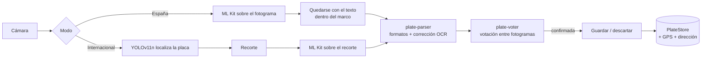

# MatriScan

App móvil (Android) que **lee matrículas con la cámara en tiempo real**, las valida contra los formatos españoles y las guarda en un historial local con fecha, ubicación y evento.

Hecha con **Angular 20 + Ionic 8 + Capacitor 8**. El reconocimiento corre **en el propio dispositivo**: ML Kit para el OCR y un modelo **YOLOv11n** (ONNX) para localizar la placa en modo internacional.

---

## Qué hace

- 📷 **Escáner en vivo**: apuntas con el marco y la app confirma la matrícula sola tras verla igual en varios fotogramas.
- 🇪🇸 **Todos los formatos españoles**: moderna, ciclomotor, provincial, antigua y especiales (remolque / histórico).
- 🌍 **Modo internacional**: detecta la placa con YOLO y acepta matrículas de otros países, leyendo el distintivo de la banda azul (F, D, P, NL…).
- 🗂️ **Historial** con búsqueda, filtros por tipo, rango de fechas (calendario) y evento, y opción de copiar las matrículas.
- 🏷️ **Eventos**: agrupa las capturas (p. ej. "Feria de Almería") y filtra por ellos.
- 🗺️ **Mapa** (Leaflet + OpenStreetMap) con dónde se escaneó cada matrícula, dirección aproximada y distancia a ti.
- 🔒 **Todo local**: los registros se guardan en el móvil (Capacitor Preferences). No hay backend.

---

## Cómo funciona



### 1. Captura y OCR

La app usa una interfaz `OcrProvider` (`src/app/core/ocr/ocr-provider.ts`) con dos implementaciones que se eligen en `main.ts`:

| Proveedor | Dónde | Cómo lee |
|---|---|---|
| `NativeOcrProvider` | Android | `camera-preview` + **ML Kit Text Recognition**. En modo internacional, el plugin nativo `PlateDetector` (Java + ONNX Runtime) localiza la placa y ML Kit lee solo el recorte. |
| `WebOcrProvider` | Navegador (`npm start`) | `getUserMedia` + **YOLO en onnxruntime-web** (modelo int8) + **Tesseract.js** sobre el recorte binarizado. |

También hay un `MockOcrProvider` que simula lecturas con ruido para desarrollar sin cámara.

En **modo España** no se usa YOLO: ML Kit lee el fotograma entero y se descartan los bloques de texto cuyo centro cae fuera del marco de puntería (`scan-frame.ts`). Es la vía rápida.

### 2. Parser de matrículas (`plate-parser.ts`)

TypeScript puro, sin dependencias, con tests (`plate-parser.spec.ts`). A partir del texto en bruto del OCR:

- Limpia acentos y separadores y trabaja línea a línea y fusionando líneas adyacentes (las placas de ciclomotor llegan partidas en 3 líneas).
- Prueba los formatos **del más estricto al más laxo** para que el ruido de fondo (un "ITV 2025") no gane a la matrícula real:

| Formato | Ejemplo | Patrón |
|---|---|---|
| Especial / prefijada | `C 1234 BCD`, `R 1234 BCD` | C/R/H + 4 dígitos + 3 letras |
| Moderna | `1234 BCD` | 4 dígitos + 3 consonantes (sin vocales, Ñ ni Q) |
| Provincial | `AL-1234-AB` | provincia + 4 dígitos + 1-2 letras |
| Antigua | `M 123456` | provincia + 4-6 dígitos |
| Extranjera | `AB123CD` | solo en modo internacional |

- **Corrige confusiones típicas del OCR según la posición**: en la parte de dígitos `O→0`, `B→8`, `S→5`…; en la de letras `0→D`, `8→B`… Cuenta cuántas correcciones hizo y elige la ventana que menos necesita. El formato provincial admite como mucho una corrección (si no, "SEAT IBIZA" acabaría siendo `SE-4718-IZ`).

### 3. Votación (`plate-voter.ts`)

Una sola lectura no basta. El `PlateVoter` acumula lecturas de fotogramas seguidos y solo confirma cuando la misma matrícula se repite:

- Lectura limpia (0 correcciones) → necesita menos votos.
- Lectura con correcciones o extranjera → necesita más.
- Si pasan 2 s sin lecturas válidas, se reinicia.

El `ScannerService` une todo en un bucle que espera a que termine cada pasada antes de lanzar la siguiente, así en móviles lentos baja el ritmo en lugar de acumular capturas.

### 4. Guardado

Al confirmar, se pide la posición GPS y se hace geocodificación inversa con **Nominatim (OpenStreetMap)** para guardar una dirección legible. Si no hay cobertura, se guarda sin dirección y se rellena más tarde.

---

## Estructura

```
src/app/
├── core/
│   ├── ocr/          # OcrProvider + implementaciones nativa, web y mock
│   ├── detection/    # YOLO en web (onnxruntime-web) y puente al plugin nativo
│   ├── plate/        # parser, votador y códigos de país
│   ├── scanner/      # bucle de escaneo y geometría del marco
│   └── storage/      # PlateStore y EventStore (Capacitor Preferences)
├── pages/
│   ├── scanner/      # cámara + marco + confirmación
│   ├── history/      # historial con filtros y calendario
│   └── location/     # mapa Leaflet
├── components/event-modal/
└── tabs/
android/app/src/main/java/com/cristian/matriculas/
└── PlateDetectorPlugin.java   # YOLOv11n en ONNX Runtime nativo
scripts/export-model.py        # descarga el modelo ONNX desde Hugging Face
```

---

## Puesta en marcha

Requisitos: Node 20+, npm, y para Android: Android Studio + JDK 21 (Android 7.0 / API 24 o superior).

```bash
npm install

# Navegador (usa Tesseract + YOLO web; necesita permiso de cámara)
npm start

# Tests del parser
npm test
```

### Android

```bash
npm run build
npx cap sync android
npx cap open android   # compilar y ejecutar desde Android Studio
```

La app pide permisos de **cámara** y **ubicación**.

### Modelo de detección

Los modelos ya están en el repo (`src/assets/models/` y `android/app/src/main/assets/`). Para volver a descargarlos:

```bash
python scripts/export-model.py
```

El modelo es [`morsetechlab/yolov11-license-plate-detection`](https://huggingface.co/morsetechlab/yolov11-license-plate-detection) y tiene su propia licencia; revísala antes de un uso comercial.

---

## Estado

Proyecto en desarrollo. Pendiente, entre otras cosas: terminar de pulir la gestión de eventos y la exportación a CSV desde la interfaz, y pasar el almacenamiento a SQLite cuando el historial crezca.

## Privacidad

Las matrículas y ubicaciones se quedan en el dispositivo. Las únicas peticiones de red son las teselas del mapa y la geocodificación inversa de OpenStreetMap.
